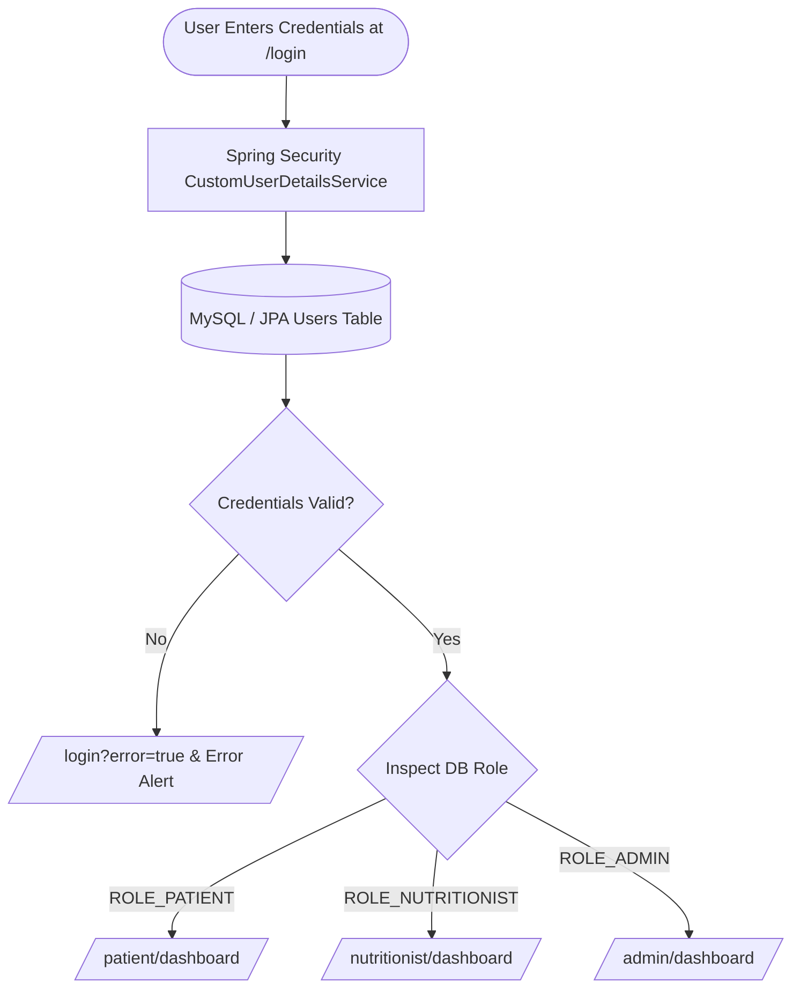
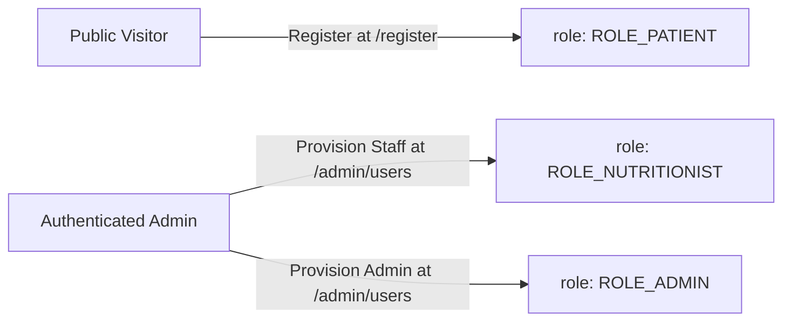
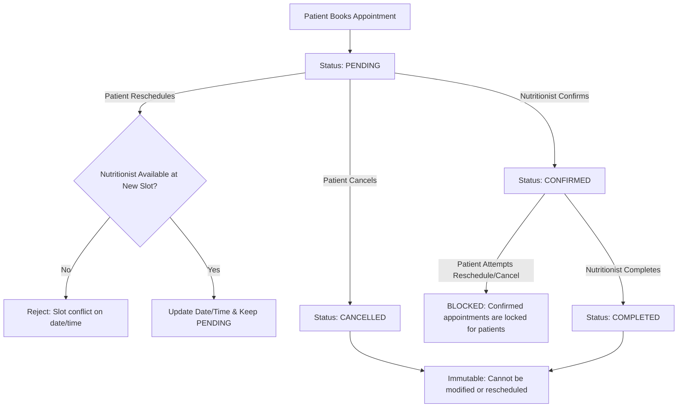

# NutriCheck Production-Grade Admin Provisioning & Security Hardening Walkthrough

This document details the production-ready first-administrator provisioning architecture, secrets hardening, security safeguards, local development workflows, and automated test results for NutriCheck.

---

## 1. Unified Authentication Flow & User Experience



1. **Single Unified Login Screen (`/login`)**:
   - One universal login portal for **all user roles** (Patients, Nutritionists, Administrators).
   - Form fields: `Username or Email Address`, `Password` (with show/hide toggle), `Remember this device for 30 days` checkbox, `Forgot password?` modal assistance.
   - **Zero Development Clutter**: All evaluation profile boxes, demo drawers, role selectors, and dev testing buttons have been completely eradicated from the DOM.
2. **Server-Side Role Resolution**:
   - The user never specifies or submits a role at login.
   - Role is loaded exclusively from the database record via `CustomUserDetailsService`.
   - `CustomAuthSuccessHandler` inspects the authenticated authority and executes role-based redirection to the appropriate dashboard.

---

## 2. Registration & Account Lifecycle Hierarchy



### A. Public Patient Registration (`/register`)
- Public page titled **"Create Patient Account"**.
- Does not expose any role selection fields.
- Backend unconditionally overrides and forces `role = Role.ROLE_PATIENT` in `UserService.registerUser()`.
- Client payload tampering (e.g. sending `role=ROLE_ADMIN`) is ignored and overridden by server-side logic.

### B. Nutritionist Staff Provisioning (`/admin/users`)
- Public registration as Nutritionist is blocked.
- Authorized Administrators provision Nutritionists via `POST /admin/users/create-nutritionist`.
- Captures clinical credentials:
  - Full Name, Username, Email, Temporary Password, Phone
  - **License / Registration Number** (e.g. `RD-94821`)
  - **Clinical Specialization** (e.g. `Diabetes & Metabolism`, `Sports Nutrition`)
- Backend strictly assigns `Role.ROLE_NUTRITIONIST` and `status = "ACTIVE"`.

### C. Administrator Provisioning (`/admin/users`)
- Public admin registration is blocked.
- The initial root administrator (`admin` / `admin123`) is seeded via `DataInitializer.java`.
- Existing administrators can provision new administrators through the controlled portal at `POST /admin/users/create-admin`.
- Endpoint requires `ROLE_ADMIN` authorization.

---

## 3. Role-Based Route Protection & Access Control

| Route Pattern | Required Authority | Unauthenticated | Unauthorized |
| :--- | :--- | :--- | :--- |
| `/css/**`, `/js/**`, `/images/**` | Public (`permitAll()`) | Allowed | Allowed |
| `/`, `/about`, `/bmi-calculator` | Public (`permitAll()`) | Allowed | Allowed |
| `/login`, `/register` | Public (`permitAll()`) | Allowed | Allowed |
| `/patient/**` | `ROLE_PATIENT` (or `ROLE_ADMIN`) | Redirect `/login` | 403 Forbidden / `/access-denied` |
| `/nutritionist/**` | `ROLE_NUTRITIONIST` (or `ROLE_ADMIN`) | Redirect `/login` | 403 Forbidden / `/access-denied` |
| `/admin/**` | `ROLE_ADMIN` strictly | Redirect `/login` | 403 Forbidden / `/access-denied` |

---

## 4. Appointment Lifecycle & Conflict Rules



| Lifecycle Rule | Backend Enforcement | Frontend Behavior |
| :--- | :--- | :--- |
| **Pending Management** | `rescheduleAppointment()` & `cancelAppointment()` allow patient modifications on `PENDING` items. | Displays `🔄 Reschedule` and `Cancel` buttons. |
| **Confirmed Lock** | Throws `IllegalStateException` if patient attempts to reschedule or cancel a `CONFIRMED` appointment. | Displays `🔒 Confirmed & Locked` badge with helper notice; hides action buttons. |
| **Cancelled Immutability** | Throws `IllegalStateException` if modifying/rescheduling a `CANCELLED` item. | Displays `Cancelled (Closed)`. |
| **Conflict & Availability** | `existsByNutritionistAndAppointmentDateAndAppointmentTimeAndStatusNotAndIdNot()` blocks bookings on occupied slots while ignoring the current item and cancelled slots. Past dates are rejected. | Blocks submission and displays specific flash conflict message. |
| **Patient Ownership** | Strictly checks `patient.id == currentUser.id`; unauthorized attempts throw `SecurityException`. | Patient only sees their own appointments. |

---

## 5. Automated Integration Test Suite Results

All **30 unit and integration test scenarios** passed with zero failures (`.\mvnw test` exits 0):

```
[INFO] -------------------------------------------------------
[INFO]  T E S T S
[INFO] -------------------------------------------------------
[INFO] Running com.nutricheck.nutricheck.AdminProvisioningTest
[INFO] Tests run: 5, Failures: 0, Errors: 0, Skipped: 0 -- in com.nutricheck.nutricheck.AdminProvisioningTest
[INFO] Running com.nutricheck.nutricheck.AppointmentWorkflowTest
[INFO] Tests run: 9, Failures: 0, Errors: 0, Skipped: 0 -- in com.nutricheck.nutricheck.AppointmentWorkflowTest
[INFO] Running com.nutricheck.nutricheck.AuthAndSecurityTest
[INFO] Tests run: 9, Failures: 0, Errors: 0, Skipped: 0 -- in com.nutricheck.nutricheck.AuthAndSecurityTest
[INFO] Running com.nutricheck.nutricheck.BmiServiceTest
[INFO] Tests run: 6, Failures: 0, Errors: 0, Skipped: 0 -- in com.nutricheck.nutricheck.BmiServiceTest
[INFO] Running com.nutricheck.nutricheck.NutricheckApplicationTests
[INFO] Tests run: 1, Failures: 0, Errors: 0, Skipped: 0 -- in com.nutricheck.nutricheck.NutricheckApplicationTests
[INFO] 
[INFO] Results:
[INFO] 
[INFO] Tests run: 30, Failures: 0, Errors: 0, Skipped: 0
[INFO] 
[INFO] ------------------------------------------------------------------------
[INFO] BUILD SUCCESS
[INFO] ------------------------------------------------------------------------
```

---

